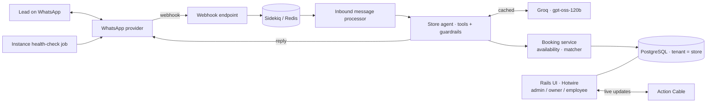

# Velora — Case Study

> Multi-tenant SaaS for service businesses: an AI agent answers leads on WhatsApp, qualifies them and books the appointment, while owners and staff follow everything in role-based dashboards.

**Status:** MVP (not in production) · **Source code:** private (team project) · **My role:** front-end lead — scheduling UI, design system, owner experience

> [!NOTE]
> This repository contains no proprietary code. It documents the problem, the architecture and my contribution.

---

## The problem

Small service businesses (barbershops, clinics, studios) get most of their leads on WhatsApp and lose many of them: replies come hours later, nobody qualifies the lead, and booking means going back and forth about free slots.

## The solution

> Conversation on WhatsApp → qualified lead → slot on the calendar.

- Each store connects its own WhatsApp number by QR code.
- An AI agent, configured per store, replies in seconds, collects the lead's data and offers **only slots the system computed as free**, based on opening hours, staff shifts, breaks and buffers.
- Dashboards by role:
  - **Admin:** fleet of WhatsApp instances, health and alerts, usage and billing.
  - **Owner:** agenda, revenue of the day, who is coming next, occupancy per professional, chat with clients.
  - **Employee:** their own schedule.

## Architecture (v2)

## Stack

-61DAFB?logo=react&logoColor=black)

- **v1 (May–Jun 2026):**
  - Rails API with a React 18 + Vite + Zustand SPA.
  - Meta WhatsApp Cloud API and OpenAI function calling.
  - LLM playground for testing agent prompts.
- **v2 (Aug–Sep 2026):**
  - Single Rails 8 app with Hotwire, ViewComponent and Tailwind.
  - Sidekiq, PostgreSQL, Redis, Devise/JWT, Pundit and rack-attack.
  - Groq (OpenAI-compatible API) as the LLM.
  - Per-store WhatsApp instances.
  - Railway deploy: web and worker from one Dockerfile.
  - GitHub Actions: Brakeman, bundler-audit, RuboCop and tests.

## Technical decisions

- **SPA → Hotwire.** v1 had a React SPA on top of a Rails API, so every feature was built twice (endpoint + client state). v2 moved to server-rendered Rails with Turbo/Action Cable for live updates. Less code, one source of truth, faster iteration for a small team.
- **The LLM picks, the server decides.** The agent can only book from slot offers the booking service generated, and the server validates them again on write. A hallucinated time can't become an appointment.
- **Cost control as a feature.** Platform-locked model, per-store response cache, token-usage reports and a daily job tracking the provider's public pricing.
- **Per-store WhatsApp provisioning by QR code** instead of the official Cloud API onboarding, so a new store goes live in minutes. The trade-off is depending on an unofficial provider, which is mitigated by health checks and self-resolving alerts.

## My role

Team of two. Arthur built the backend core (WhatsApp integration, agents and tools, booking engine, pricing). I led the **front end and the owner experience**.

**v1 (React):**
- Built the weekly agenda: 24h grid, popover editing, monthly block navigation, column alignment and scroll fixes.
- Redesigned every screen with the new design system and added a light theme with a toggle.
- Built the admin flow to create a store owner, and polished the UX of the prompt playground.

**v2 (Hotwire):**
- Owned the owner area: views, controllers and request specs.
- Gave owners write access to the agenda, so they can book a client who called by phone. The agenda now reads like a working day.
- Built reports: revenue today, next clients and occupancy per professional.
- Let owners reply to a client from inside the app.
- Added weekly shifts per professional, with separate Saturday hours.
- Added store-defined AI instructions, removing a fallback that impersonated the store.
- Search and findability, accessible data tables, and click-to-WhatsApp on lead phones.

## Team

- **Arthur Ferreira** ([@Arthur-FerreiraDev](https://github.com/Arthur-FerreiraDev)) — backend core: WhatsApp integration, agents and tools, booking engine, pricing
- **Davi Sales** ([@daavisales](https://github.com/daavisales)) — front-end lead: scheduling UI, design system, owner experience

## Challenges

- Throwing away a working SPA mid-project. Deciding *when* a rewrite pays off was harder than the rewrite itself.
- Calendar grids are unforgiving: alignment, overflow and time zones (America/Sao_Paulo) across day/week views.
- Merging a long-running design branch into an actively changing codebase.

## Next steps

- Automatic reminders and no-show tracking.
- Self-service onboarding for new stores.
